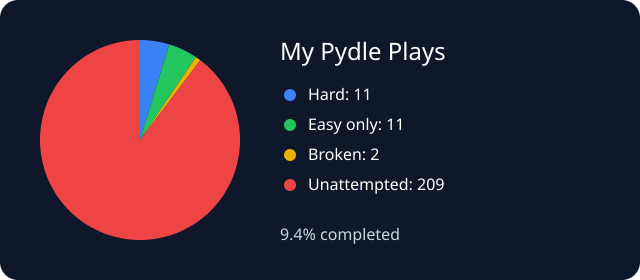

# My Pydle Plays

My attempts at [Pydle](https://pydle.net), one Python puzzle at a time 🐍

<!-- pydle-progress:start -->
**19 games completed** · **21 attempted** · **2 broken**



Archive percentage and unattempted games will appear after the first successful update.
<!-- pydle-progress:end -->

All my attempts are in [`games/`](games). Each filename starts with its game number, like `#73 Frog.py`.

Progress updates automatically on every push to the default branch and every day through GitHub Actions. The Action generates `assets/pydle-progress.svg` and commits it with the updated README. The pie chart shows completed games, broken attempts, and unattempted games. Files marked `(broken)` count as attempted, but don't count as completed. Each game number counts once; if I save a working solution for a broken game, it moves to completed. Only numbers found in the live archive count toward the percentage.

To refresh manually, run **Update Pydle progress** from the Actions tab. If needed, set the repository variable `PYDLE_ARCHIVE_URL` to the archive's URL; otherwise the updater opens the archive from the homepage.

For a local refresh:

```sh
python -m pip install playwright==1.58.0
python -m playwright install chromium
python scripts/update_progress.py
```

If the archive can't be read, the workflow fails and keeps the previous progress display.
